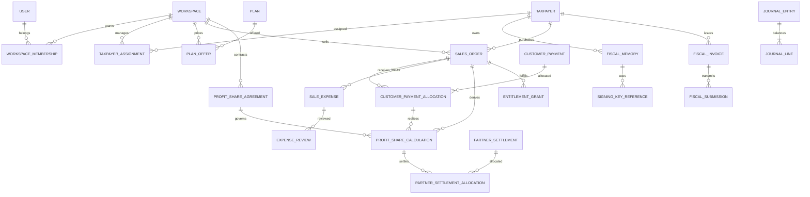

# Phase 01 — Step 05: Logical ERD v1 and financial invariants

Status: DESIGN DRAFT (no database migration executed). Reference: ADR-0001/0002/0003.
This is the target **logical model**, not a claim about implemented tables.

## Core schema (Mermaid)

## Entities and critical fields

- WORKSPACE(id PK, ownerDelegateUserId FK, name, status, rowVersion): one delegate financial/security boundary; Root supervision is a separate privileged policy.
- WORKSPACE_MEMBERSHIP(id PK, workspaceId FK, userId FK, role, validFrom, validTo): unique active membership per user/workspace/role.
- TAXPAYER(id PK, kind NATURAL|LEGAL, nationalOrRegistrationId, economicCode, displayName), TAXPAYER_ASSIGNMENT(id PK, workspaceId FK, taxpayerId FK, grantedByRootId FK, validFrom, revokedAt). Assignment uniqueness and ownership/exclusivity are explicit policy checks; avoid unguarded cross-workspace joins.
- FISCAL_MEMORY(id PK, taxpayerId FK, memoryCode, state), SIGNING_KEY_REFERENCE(id PK, memoryId FK, vaultPointer, publicKeyFingerprint, certificateFingerprint, status, generationMethod). Never store unencrypted PEM or CSR private material in ordinary tables.
- PLAN(id PK, kind ANNUAL|QUANTITY, baseEntitlementDefinition), PLAN_OFFER(id PK, workspaceId FK, planId FK, taxpayerId nullable FK, priceMinorUnits, currency, effectiveFrom, effectiveTo, revision). A company-specific offer overrides a workspace offer only within the same workspace. No cross-workspace visibility.
- SALES_ORDER(id PK, workspaceId FK, taxpayerId FK, planOfferId FK, type INITIAL|RENEWAL|QUANTITY_TOPUP|ADJUSTMENT, priceSnapshotMinorUnits, currency, agreementRevision, issuedAt, status, idempotencyKey). Unique(workspaceId,idempotencyKey); preserve price snapshot forever.
- CUSTOMER_PAYMENT(id PK, workspaceId FK, method CASH|GATEWAY|BANK, externalReference, receivedAt, amountMinorUnits, currency, status, idempotencyKey); unique(workspaceId,method,externalReference) where applicable. A gateway callback is not proof of cash until verified.
- CUSTOMER_PAYMENT_ALLOCATION(id PK, paymentId FK, orderId FK, amountMinorUnits, postedAt, reversalOfId nullable): allocations cannot exceed verified net payment or outstanding order balance. Order and payment must share workspace, taxpayer ownership must be authorized.
- SALE_EXPENSE(id PK, orderId FK, category, totalAmountMinorUnits, taxComponentMinorUnits, eligibleAmountMinorUnits, evidenceHash, submittedBy, status, revision), EXPENSE_REVIEW(id PK, expenseId FK, reviewerRootUserId FK, decision APPROVE|REJECT|RETURN, reviewedAt, reason, approvedEligibleAmountMinorUnits). Root-only; append-only review history; an expense cannot self-approve.
- PROFIT_SHARE_AGREEMENT(id PK, workspaceId FK, rootPercentBasisPoints, delegatePercentBasisPoints, validFrom, validTo, policyVersion). Percentages total exactly 10000 basis points, commonly 5000/5000.
- PROFIT_SHARE_CALCULATION(id PK, orderId FK, paymentAllocationId FK, agreementId FK, version, realizedNetRevenueMinorUnits, approvedCostAllocatedMinorUnits, distributableProfitMinorUnits, rootShareMinorUnits, delegateShareMinorUnits, status, snapshotHash). Derived only from **actual verified collection** allocated to the order. Unpaid receivables have zero realized partner shares. Recalculate via additive corrections/reversal, never mutate posted historical shares.
- PARTNER_SETTLEMENT(id PK, workspaceId FK, amountMinorUnits, currency, bankReference, submittedAt, confirmedByRootId, confirmedAt, status), PARTNER_SETTLEMENT_ALLOCATION(id PK, settlementId FK, profitCalculationId FK, amountMinorUnits, reversalOfId nullable). Confirmed settlement allocations cannot exceed available root partner liability. A single transfer may settle many orders/companies.
- ENTITLEMENT_GRANT(id PK, orderId FK, taxpayerId nullable FK, kind, quantity, validTo, activationPolicy, state): service activation/quantity release is a separate contractual decision from partner settlement.
- FISCAL_INVOICE(id PK, taxpayerId FK, memoryId FK, taxId, sourceSystem, sourceRecordId, fiscalRuleVersion, payloadVersion, status), FISCAL_SUBMISSION(id PK, invoiceId FK, requestUid, referenceNumber, status, attempt, createdAt).
- JOURNAL_ENTRY(id PK, workspaceId FK, eventType, eventId, postedAt, currency, reversalOfId nullable), JOURNAL_LINE(id PK, entryId FK, accountCode, debitMinorUnits, creditMinorUnits, taxpayerId nullable FK, orderId nullable FK). Per-entry debit == credit; append-only.

## Cash basis, VAT, and cost allocation

For each verified customer receipt allocated to an order, calculate an immutable realization slice:
1. Determine the cash received and allocated to that order, split into VAT/pass-through and tax-exclusive revenue according to **documented taxable treatment** and original order snapshot. Never treat output VAT as operational revenue or deduct it twice.
2. Attribute only appropriately evidenced, Root-approved eligible expenses to the slice under a documented allocation policy (e.g. proportional across collections); prevent expense double-allocation across multiple receipts.
3. DistributableProfit = RealizedTaxExclusiveRevenue - ApprovedEligibleCostsAllocated. Profit share = distributable profit * agreement basis points / 10000, deterministic minor-unit rounding; last-share remainder assigned by an agreed documented rule.
4. If expenses exceed realized revenue, the slice yields a loss; do **not** create a negative payable without an explicit negotiated loss/offset policy.
5. A subsequent receipt generates its own realization slice. Refunds, chargebacks, corrections and settlement reversals post compensating entries; linked history is never deleted.
6. Cash collected, partner profit earned, and bank settlement are three separate events/state machines. Each customer/company settlement report is a derived aggregation of constituent orders, receipts, approved expenses, computed shares, confirmed allocations, and outstanding amounts.

## Security/integrity acceptance tests

1. Delegate A cannot read/write B's plan prices, payment accounts, payments, costs, settlements or taxpayer documents even by guessed ID or direct API access.
2. Only Root can approve expenses and confirm final inter-partner settlement; approval is immutable, attributable and audited.
3. Underpaid order 1,000,000 / received 600,000: only 600,000 allocated cash (with applicable tax split) enters profit-sharing; unpaid 400,000 is a receivable.
4. Separate initial purchase, renewal and quantity top-up produce separate order profit/settlement balances for the same company.
5. One payment across multiple orders, one settlement across multiple orders, partial settlement and retrying both operations must preserve balanced totals.
6. Concurrent duplicate gateway callbacks/settlements cannot double-post allocations, entitlements or shares.
7. Editing the price list, tax configuration or 50/50 agreement after sale does not rewrite prior financial snapshots.
8. Verify reversal and rounding invariants with property-based and concurrency tests.

## Open decisions before implementation

- Confirm whether one taxpayer can be concurrently assigned to multiple delegate workspaces; default deny overlapping active assignments pending business decision.
- Which categories of costs are deductible, proportional allocation method for installments, and how losses/chargebacks are shared.
- Whether entitlement activation occurs on partial payment, full payment, or explicit credit terms.
- Evidence retention, Root approval workflow and reconciliation periods.
- This is an architectural design; PostgreSQL constraints/RLS/index strategy and EF Core migrations are Phase 02 deliverables.
